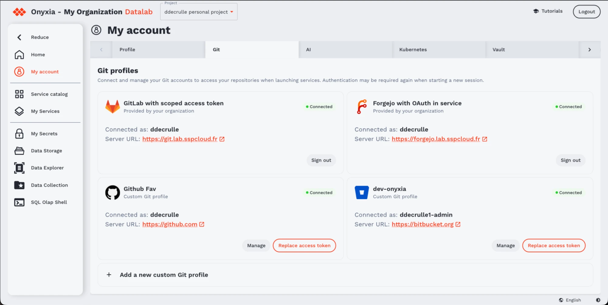
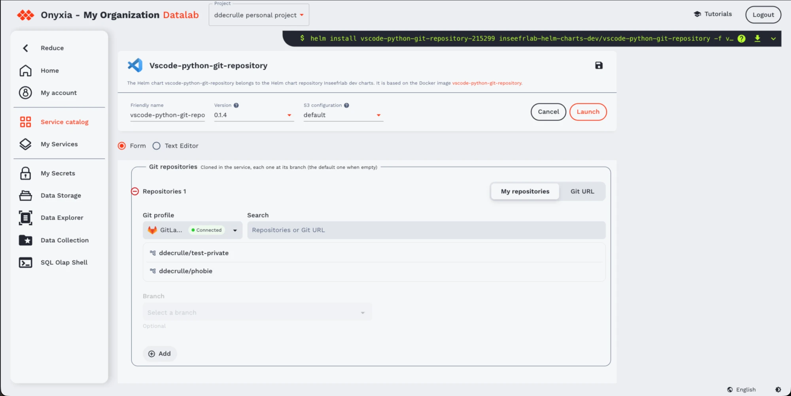
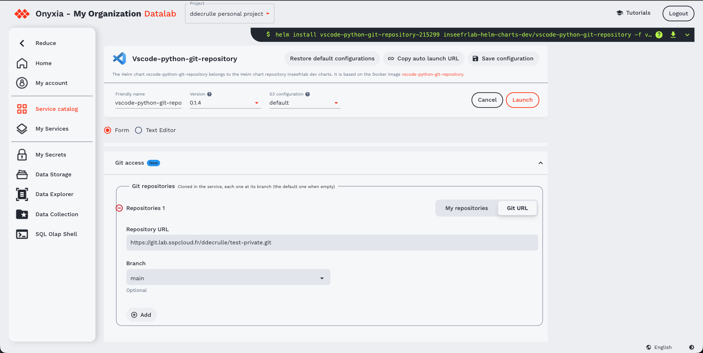

# Git integration

Onyxia's main use case is launching IDE environments such as VS Code, Jupyter, and RStudio, and most of the work done there lives in a Git repository.

With the Git integration, users connect their Git accounts (GitLab, Forgejo, GitHub, Bitbucket Cloud) once, in **My account > Git**. Depending on how you configure each forge, they either sign in through a popup (OAuth) or paste a personal access token. Personal access tokens are [stored in Vault](readme/vault.md) when Vault is configured, or in browser storage otherwise; OAuth sessions always stay in the browser.

<figure><figcaption><p>My account > Git: two forges provided by the organization, and two profiles the user added with a personal access token</p></figcaption></figure>

When launching a service, users pick the repositories to clone, each at a branch: either by searching the repositories of one of their connected accounts, or by pasting any HTTPS clone URL.

<figure><figcaption><p>Searching the repositories of a connected account</p></figcaption></figure>

<figure><figcaption><p>Pasting a clone URL, then choosing the branch</p></figcaption></figure>

The service starts with the repositories cloned, the user's name and email configured for each forge, and credentials ready: `git pull` and `git push` work without any manual setup.


Nothing happens in the services until the catalog charts get the new Git form. See [Enable it in the catalog charts](#enable-it-in-the-catalog-charts).


<details>

<summary>Understanding what Onyxia does</summary>

Onyxia talks to the forges from the user's browser: it identifies the user, lists their repositories and branches, and obtains the credentials meant for the services when the user clicks **Launch**.

It then passes the connected accounts, with their credentials, and the selected repositories to the service through [the XOnyxia launcher context (`xOnyxia.git`)](catalog-of-services/custom-catalogs/onyxia-extension.md). The service is responsible for configuring Git and cloning the repositories; the images of the [catalog of interactive services](https://github.com/InseeFrLab/helm-charts-interactive-services) do it in [their init script](https://github.com/InseeFrLab/images-datascience/blob/main/base/scripts/onyxia-init.sh#L105).

</details>

## API Reference

Git integration settings are defined in the region configuration:



```yaml
onyxia:
  api:
    regions:
      - { ? // The Git integration configuration object
            gitProviders
          : { providers: [...] } }
```



The Git integration configuration object has the following shape:



```typescript
/**
 * JSON5 configuration accepted by the `GIT_PROVIDERS` environment variable
 * (`gitProviders` in the region configuration). Controls Account > Git and the
 * `git` launch context that charts use to clone and push from the services.
 *
 * Omitting it (an empty `GIT_PROVIDERS`) enables the integration with no
 * admin-provided provider: users add their own. To disable it, use
 * `{ providers: [], disallowUserToAddProviders: true }`.
 *
 * This configuration is exposed to the browser and must not contain secrets: the
 * OAuth applications are public clients, without secret.
 */
type GitProvidersConfigObject = {
  /**
   * Markdown displayed below the "Git profiles" heading in Account > Git. Accepts
   * a string or translations such as `{ en: "...", fr: "..." }`. Omit to show the
   * default text.
   */
  description?: LocalizedString;
  /**
   * Providers provisioned by the administrator. Use `[]` to provision none.
   */
  providers: GitProvidersConfigObject.Provider[];
  /**
   * Prevents users from adding their own providers (gitlab.com, github.com...)
   * with a personal access token.
   * @default false
   */
  disallowUserToAddProviders?: boolean;
};

namespace GitProvidersConfigObject {
  export type Provider = {
    /** `bitbucket` is Bitbucket Cloud only (`https://bitbucket.org`). */
    type: "gitlab" | "forgejo" | "github" | "bitbucket";
    /** Base URL of the forge, for example `https://gitlab.example.com`. */
    url: string;
    /**
     * Name displayed in Account > Git. Must be unique among the providers.
     *
     * Keep it stable: the user's tokens and sessions are saved under it, so
     * renaming a provider signs its users out.
     * @default the host of `url`
     */
    displayName?: string;
    /**
     * One absolute URL for both themes or `{ light: "https://...", dark: "https://..." }`.
     * @default the logo of the forge type
     */
    logoUrl?: string | { light: string; dark: string };
    /**
     * Supported combinations (`ui` / `service`):
     * - `personal-access-token` / `personal-access-token`: every forge type.
     * - `oauth` / `oauth`: GitLab, Forgejo.
     * - `oauth` / `scoped-access-token`: GitLab 19.2 or later (recommended).
     *
     * Onyxia refuses any other combination at startup.
     */
    authentication: {
      /** How Onyxia accesses the forge to list the user's repositories and branches. */
      ui:
        | {
            /** The user signs in to the forge through a popup. */
            type: "oauth";
            /** The public OAuth application registered for Onyxia. */
            clientId: string;
          }
        | {
            /** The user pastes a token in Account > Git. */
            type: "personal-access-token";
          };
      /** What the launched services receive to clone and push. */
      service:
        | {
            /** The token the user pasted in Account > Git. */
            type: "personal-access-token";
          }
        | {
            /**
             * Onyxia creates a token dedicated to the service, limited to
             * cloning and pushing, when the user clicks Launch. GitLab only.
             */
            type: "scoped-access-token";
            /** @default 30 */
            lifetimeDays?: number;
          }
        | {
            /** The service gets its own OAuth authorization when the user clicks Launch. */
            type: "oauth";
            /** A public OAuth application distinct from Onyxia's (`ui.clientId`). */
            clientId: string;
          };
    };
  };
}
```



## Example Configurations

The examples below assume Onyxia is deployed at `https://datalab.my-domain.net`.

### GitLab

The recommended setup for a GitLab instance: users sign in with OAuth, and every service gets its own token, which expires on its own and can be revoked from GitLab without affecting the other services. It requires **GitLab 19.2 or later**, with fine-grained personal access tokens enabled.



```yaml
onyxia:
  api:
    regions:
      - {
          gitProviders:
            {
              description:
                {
                  en: "Connect your Git accounts to clone and push from your services. [Read more](https://example.com/git)",
                  fr: "Connectez vos comptes Git pour cloner et pousser depuis vos services. [En savoir plus](https://example.com/git)",
                },
              providers:
                [
                  {
                    type: "gitlab",
                    url: "https://gitlab.my-domain.net",
                    displayName: "Organization GitLab",
                    authentication:
                      {
                        ui: { type: "oauth", clientId: "<Application ID>" },
                        service:
                          { type: "scoped-access-token", lifetimeDays: 30 },
                      },
                  },
                ],
            },
        }
```



To create the OAuth application, as a GitLab administrator:

1. Go to **Admin area > Applications** and click **Add new application**. Without admin rights, a group owner can do the same in the group's **Settings > Applications**.
2. **Name:** `Onyxia`.
3. **Redirect URI:** `https://datalab.my-domain.net/git/oauth/callback` (your Onyxia URL followed by `/git/oauth/callback`).
4. **Confidential:** uncheck it (it is checked by default). Onyxia has no client secret.
5. **Scopes:** check `api` only. Onyxia needs it to create the services' tokens.
6. Click **Save application** and copy the **Application ID** into `clientId`. Ignore the secret.

<details>

<summary>GitLab before 19.2</summary>

Give each service its own OAuth authorization instead. Create two applications as above, with the same redirect URI and **Confidential** unchecked, but with these scopes:

- Onyxia's application: `read_api`
- The services' application: `read_repository` and `write_repository`

```yaml
authentication:
  {
    ui: { type: "oauth", clientId: "<Application ID of Onyxia's application>" },
    service:
      {
        type: "oauth",
        clientId: "<Application ID of the services' application>",
      },
  }
```

</details>

### Forgejo

Forgejo supports OAuth for both Onyxia and the services:



```yaml
onyxia:
  api:
    regions:
      - {
          gitProviders:
            {
              providers:
                [
                  {
                    type: "forgejo",
                    url: "https://forgejo.my-domain.net",
                    authentication:
                      {
                        ui:
                          {
                            type: "oauth",
                            clientId: "<Client ID of Onyxia's application>",
                          },
                        service:
                          {
                            type: "oauth",
                            clientId: "<Client ID of the services' application>",
                          },
                      },
                  },
                ],
            },
        }
```



Create two OAuth2 applications, one for Onyxia and one for the services. For each, as a Forgejo administrator:

1. Go to **Site administration > Integrations > Applications**.
2. **Application name:** for example `Onyxia` and `Onyxia services`.
3. **Redirect URIs:** `https://datalab.my-domain.net/git/oauth/callback` (your Onyxia URL followed by `/git/oauth/callback`), for both applications.
4. **Confidential client:** uncheck it (it is checked by default).
5. Click **Create application** and copy the **Client ID** into the matching `clientId`. Ignore the client secret.

Forgejo doesn't ask for scopes: Onyxia requests them when the user signs in.

Onyxia calls the Forgejo API from the browser, so Forgejo must allow cross-origin requests, which it doesn't by default. In its `app.ini`:

```ini
[cors]
ENABLED = true
```


Forgejo doesn't enforce OAuth scopes yet: its OAuth tokens have every right of the user.


### GitHub

GitHub doesn't allow OAuth from the browser without a client secret: users paste a personal access token, which the services also receive. Onyxia shows them a link to create it with the right permissions.



```yaml
onyxia:
  api:
    regions:
      - {
          gitProviders:
            {
              providers:
                [
                  {
                    type: "github",
                    url: "https://github.com",
                    authentication:
                      {
                        ui: { type: "personal-access-token" },
                        service: { type: "personal-access-token" },
                      },
                  },
                ],
            },
        }
```



Nothing needs to be configured on GitHub's side. For GitHub Enterprise Server, set `url` to your instance.

### Bitbucket Cloud

Like GitHub, users paste a token: an [Atlassian API token](https://id.atlassian.com/manage-profile/security/api-tokens) with the scopes `read:user:bitbucket`, `read:workspace:bitbucket`, `read:repository:bitbucket` and `write:repository:bitbucket`. Only `https://bitbucket.org` is supported, not Bitbucket Data Center.

```yaml
{
  type: "bitbucket",
  url: "https://bitbucket.org",
  authentication:
    {
      ui: { type: "personal-access-token" },
      service: { type: "personal-access-token" },
    },
}
```

### Only the forges of your organization

By default, users can also add forges of their own (gitlab.com, github.com...) with a personal access token. To offer only the providers you declare:



```yaml
onyxia:
  api:
    regions:
      - { gitProviders: { disallowUserToAddProviders: true, providers: [...] } }
```



## Enable it in the catalog charts


Without this step, nothing happens: the launcher shows no repository field and the services get no credentials, even with accounts connected in **My account > Git**.


The IDE charts of [InseeFrLab/helm-charts-interactive-services](https://github.com/InseeFrLab/helm-charts-interactive-services) take their Git form from the `ide/git.json` schema served by Onyxia API (through [`overwriteSchemaWith`](catalog-of-services/override-schema-for-a-specific-instance.md)). The one shipped with Onyxia API predates the Git integration. Replace it in the `schemas.files` of the Onyxia Helm chart:



```yaml
onyxia:
  api:
    schemas:
      enabled: true
      files:
        - relativePath: ide/git.json
          content: |
            {
              "$schema": "http://json-schema.org/draft-07/schema#",
              "title": "Git",
              "description": "Git user configuration",
              "type": "object",
              "properties": {
                "enabled": {
                    "type": "boolean",
                    "default": true,
                    "hidden": true
                },
                "providers": {
                  "description": "The connected Git providers (identity and credentials), filled by Onyxia",
                  "type": "array",
                  "default": [],
                  "hidden": true,
                  "x-onyxia": { "overwriteDefaultWith": "{{git.providers}}" },
                  "items": { "type": "object", "additionalProperties": true }
                },
                "repositories": {
                  "title": "Repositories",
                  "description": "Cloned when the service starts",
                  "type": "array",
                  "default": [
                    {
                      "providerId": "",
                      "url": "",
                      "branch": ""
                    }
                  ],
                  "items": {
                    "type": "object",
                    "render": "gitRepository",
                    "properties": {
                      "providerId": { "type": "string", "default": "" },
                      "url": { "type": "string", "default": "" },
                      "branch": { "type": "string", "default": "" }
                    }
                  },
                  "hidden": { "value": false, "path": "enabled", "isPathRelative": true }
                }
              }
            }
```




This schema requires charts built on the [library chart](https://github.com/InseeFrLab/helm-charts-interactive-services/tree/main/charts/library-chart) **2.1.11 or later**: earlier versions don't pass `git.providers` and `git.repositories` to the service, so nothing is cloned. Check the `library-chart` dependency in the `Chart.yaml` of each chart of your catalog. The images must also be recent [images-datascience](https://github.com/InseeFrLab/images-datascience) images, which read the `GIT_PROVIDERS` and `GIT_REPOSITORIES` variables.


Keep the `enabled` property. The charts mount the Git secret only when `git.enabled` is `true`. Without it in the schema, Onyxia sends no value and each chart falls back on the default in its own `values.yaml`: `true` for `vscode-python`, but `false` for `jupyter-python`, where the services then get no Git variables at all.


To try the new form with a group of users first, use a [role-based override](catalog-of-services/override-schema-for-a-specific-instance.md#role-based-overrides-different-schema-per-user-role).


If you build your own charts, the `git.providers` context is described in the [x-onyxia documentation](catalog-of-services/custom-catalogs/onyxia-extension.md). The [library chart](https://github.com/InseeFrLab/helm-charts-interactive-services/blob/main/charts/library-chart/templates/_secret.tpl) of the interactive services shows how to pass it to a service.
