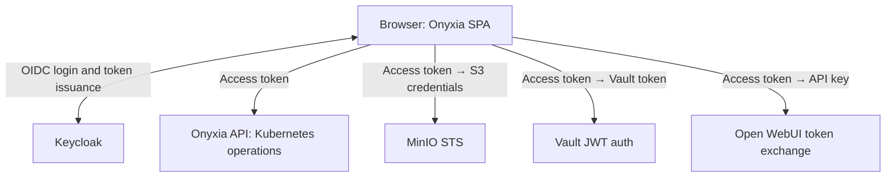

# User authentication

Enable authentication so users can sign in to Onyxia and launch services in their own Kubernetes namespaces. This installation guide uses Keycloak and the realm `datalab`.

## Deploying Keycloak

Deploy Keycloak through ArgoCD, as you deployed Onyxia in the previous step.

Before deploying, open [apps/keycloak/values.yaml](https://github.com/garronej/onyxia-ops/blob/main/apps/keycloak/values.yaml) in your GitOps repository and replace the `CHANGEME` password placeholders. Keep the `keycloak.auth.adminPassword` value: you will use it to access the admin console.




When updating [the Onyxia chart](https://github.com/garronej/onyxia-ops/blob/main/apps/onyxia/Chart.yaml), also keep the Onyxia Keycloak theme download in [apps/keycloak/values.yaml](https://github.com/garronej/onyxia-ops/blob/main/apps/keycloak/values.yaml) up to date.


## Configuring Keycloak

Open the admin console at `https://auth.lab.my-domain.net` and sign in with username `keycloak` and the admin password configured above.

### One login, several services

Onyxia is a SPA: the browser authenticates directly with Keycloak using Authorization Code with PKCE. Keycloak issues an access token to the **public client `onyxia`**, and Onyxia uses it with the configured resource servers:



S3, Vault, and Open WebUI are optional and configured later; we prepare their authentication settings now. Each service validates the token's issuer and audience, then applies its own authorization policies.

**This guide is specific to Keycloak**, whose authorization server can issue one token for several resource servers. Onyxia also supports [a token per resource server with other IAM systems](#other-iam-systems).

### Use the reference realm

Open **[apps/keycloak/realm-export.json](https://github.com/garronej/onyxia-ops/blob/main/apps/keycloak/realm-export.json)**, replace **every occurrence of `my-domain.net` with your domain**, and import it as a new realm through the admin console. For an existing realm, apply the client and mapper configuration below.

The reference assumes the **Onyxia theme and RFC1123 username mapper are loaded**; the deployment above supplies both. The theme is optional and explains registration constraints; the mapper is optional but strongly recommended.

Adapt these account settings:

- **Registration:** update the email validation pattern in the realm's **User Profile** to allow your chosen domains or addresses. The demo allows `insee.fr`, `gouv.fr`, and their subdomains.
- **Email verification:** for local registration, configure SMTP and enable email verification, which is disabled in the demo. If an external provider such as Google or GitHub supplies verified email addresses that Keycloak trusts, [Keycloak need not send its own verification email](https://www.keycloak.org/docs/latest/server_admin/index.html#_identity_broker).

Replace masked SMTP and confidential-client secrets with actual credentials when configuring them. Registration, session duration, language, and other account policies are your choice.

### The `onyxia` client and its token

The `onyxia` client is public: **Client authentication Off**. Set redirect URIs and web origins for your Onyxia URL.

The other clients represent the services. MinIO Console and Open WebUI also use confidential clients for their own login flows; Onyxia API and Vault validate the SPA's token offline so they don't strictly need a client in Keycloak but it's a good practice to declare them regardless since
service specific role are beter defined in a specifc client rather than at the real level.

Here is an access-token excerpt for a user with the example roles and group:

```jsonc
{
  "iss": "https://auth.lab.my-domain.net/realms/datalab",
  "aud": ["openwebui", "vault", "onyxia-api", "minio"],
  "azp": "onyxia",
  // For example, here we have a "vip" role for Onyxia API that can be configured
  // to allow the allocation of expensive GPU like H100.
  "onyxia-roles": ["vip"],
  "openwebui-roles": ["admin"],
  "onyxia-username": "garronej",
  "name": "Joseph Garrone",
  // This is what defines what group projects the user have access to beyound
  // their personal one. (Shared Kubernetes namespace and S3 storage among a group of user)
  "groups": ["onyxia-admin"],
  "email": "joseph.garrone@insee.fr",
  "minio-policy": "stsonly"
}
```

The reference configures these mappers on **`onyxia`**, through its dedicated scope, **`onyxia-dedicated`**:

| Claim | Mapper and configuration |
| --- | --- |
| `aud` | Four Audience mappers: Included Client Audience `minio`, `vault`, `openwebui` and `onyxia-api`. These audiences apply to all users, independently of roles. |
| `onyxia-username` | RFC1123 Username mapper, with Token Claim Name `onyxia-username`. |
| `minio-policy` | Hardcoded claim: String value `stsonly`. |
| `groups` (optional) | Group Membership mapper, Full group path Off. Enables shared Kubernetes namespaces and S3 storage. |
| `onyxia-roles` (optional) | User Client Role mapper for `onyxia-api`, Multivalued On, JSON type String. The `vip` role selects role-specific configuration; see [values-kitchen-sink.yaml](https://github.com/garronej/onyxia-ops/blob/main/apps/onyxia/values-kitchen-sink.yaml). |
| `openwebui-roles` (optional) | User Client Role mapper for `openwebui`, Multivalued On, JSON type String. The `admin` role grants privileges with the matching [Open WebUI settings](https://github.com/garronej/onyxia-ops/blob/main/apps/ollama/values.yaml). |

#### The username and storage claims

`onyxia-username` must be **unique, stable, and RFC1123 compatible** because it identifies personal namespaces and storage paths. The [custom mapper](https://github.com/onyxia-datalab/keycloak-rfc1123-username) persists a compatible identifier and handles collisions without changing the user's login name. A registration regexp can constrain new usernames, but cannot repair an existing user base. Preserve existing resource identifiers when adopting the mapper. Group names used in resource names must also be compatible.

[The MinIO configuration](https://github.com/garronej/onyxia-ops/blob/main/apps/minio/values.yaml) expects **`"minio-policy": "stsonly"`**. That policy uses `${jwt:onyxia-username}` to restrict access to the user's personal bucket. For direct MinIO Console login, also add the username mapper to `minio`; the reference currently includes it only on `onyxia`.

## Updating the Onyxia configuration

In your GitOps checkout, apply [values-keycloak-enabled.yaml](https://github.com/garronej/onyxia-ops/blob/main/apps/onyxia/values-keycloak-enabled.yaml) to [apps/onyxia/values.yaml](https://github.com/garronej/onyxia-ops/blob/main/apps/onyxia/values.yaml), merging it with your existing ingress and region settings. Replace `$DOMAIN` in the example file with your domain. The authentication settings are:


```yaml
onyxia:
  api:
    env:
      authentication.mode: "openidconnect"
      oidc.issuer-uri: "https://auth.lab.my-domain.net/realms/datalab"
      oidc.clientID: "onyxia"
      oidc.audience: "onyxia-api"
      oidc.username-claim: "onyxia-username"
      oidc.roles-claim: "onyxia-roles"
      oidc.groups-claim: "groups"
```


Replace `my-domain.net` in the snippet with your domain, then commit and push from the repository root:

```bash
git add apps/onyxia/values.yaml
git commit -m "Enable Keycloak authentication"
git push
```

After ArgoCD synchronizes the application, sign in to Onyxia and check a fresh access token against the claims above.

<figure><figcaption><p>The Onyxia sign-in page</p></figcaption></figure>

## Other IAM systems

This single-token setup does not apply directly to systems such as [Microsoft Entra ID](https://learn.microsoft.com/en-us/entra/msal/javascript/browser/resources-and-scopes) or [Auth0](https://auth0.com/docs/secure/tokens/access-tokens/get-access-tokens), which issue separate tokens for distinct resources.

**Onyxia supports a token per resource server through scope or audience configuration.** That setup is outside this Keycloak guide. **Contact the Onyxia team to integrate any other IAM system; we will help you configure it**, including hands-on support.

See [OpenID Connect Configuration](../openid-connect-configuration.md) for the configuration reference.

Next, enable S3 storage:


[Data (S3)](data-s3.md)

